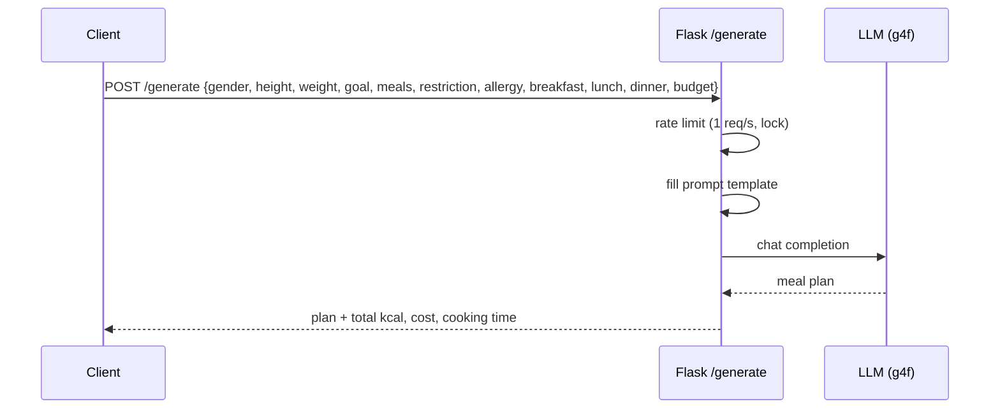

# pybot — AI meal-plan API

A small Flask service that generates a **one-day meal plan** tailored to the user — sex, height, weight, goal, number of meals, dietary restrictions, allergies, maximum cooking time and budget — using an LLM through the g4f client. The response includes the menu with total calories, cost and cooking time.

## Flow



## Request parameters

| Field | Meaning |
|---|---|
| `gender`, `height`, `weight` | body parameters |
| `goal` | nutrition goal (lose / keep / gain weight…) |
| `meals` | number of meals per day |
| `restriction`, `allergy` | dietary restrictions and allergies |
| `breakfast`, `lunch`, `dinner` | maximum cooking time for each meal, minutes |
| `budget` | budget for the whole day, ₽ |

## Run

```bash
pip install flask g4f
python main.py
```

## Stack

Python, Flask, g4f.
